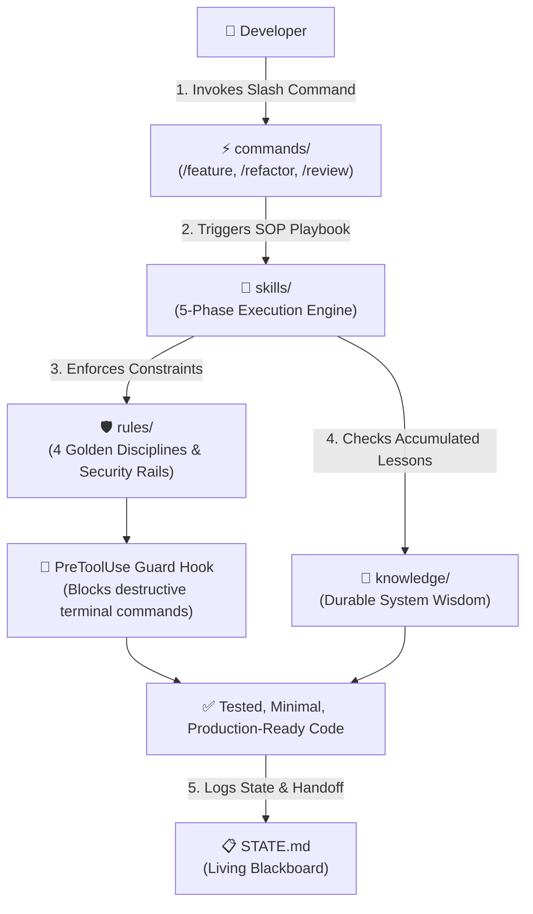

# 🧠 Universal AI Operating System (AI-OS)

### The Production-Ready, Vendor-Agnostic AI Development Framework for Modern Software Engineering.

[](https://github.com/vantu1998/universal-ai-starter/releases)
[](https://github.com/vantu1998/universal-ai-starter/actions)
[](https://opensource.org/licenses/MIT)
[](https://github.com/vantu1998/universal-ai-starter/generate)
[](#-universal-compatibility)

<p align="center">
  <b>Tired of AI amnesia, context drift, hallucinated architecture, and vendor lock-in?</b><br>
  Universal AI-OS is a lightweight, spec-driven in-repo framework that turns LLMs from chaotic vibe-coders into disciplined Senior Engineers.
</p>

[Quick Start](#-quickstart-in-60-seconds) •
[Why AI-OS?](#-the-problem-vs-the-solution) •
[The 4 Pillars](#-the-4-pillars-architecture) •
[Security & Guardrails](#-security--execution-guardrails) •
[Quota-Safe Handover](#-quota-safe-ai-handover-blackboard-pattern) •
[Commands & Skills](#-the-core-4-slash-commands)

---

## 💥 The Problem vs. The Solution

| Pain Point | Typical AI Coding (Vibe Coding) | With Universal AI-OS (Spec-Driven) |
| :--- | :--- | :--- |
| **Context Drift & Amnesia** | Long chats dilute attention, burning tokens and forgetting architecture after 20 messages. | **File-as-State:** Context is anchored in `STATE.md` and `.ai/` context maps. Reset context anytime with zero loss. |
| **Vendor Lock-in** | Prompts and rules are trapped inside proprietary IDE panels (Cursor, Claude, Copilot). | **Vendor-Agnostic:** 100% interoperable. Switch between Cursor, Claude Code, Antigravity, or Windsurf instantly. |
| **Code Quality & Bloat** | AI writes speculative, overcomplicated abstractions and breaks domain invariants. | **4 Golden Disciplines:** Think before coding, Simplicity first, Surgical changes, Test-verified execution. |
| **Security Risks** | AI executes destructive terminal commands or exposes `.env` secrets without permission. | **Enforced Safety Rails:** PreToolUse hook blocks destructive commands; scoped security rules always active. |
| **Repeat Mistakes** | AI repeats the exact same subtle production bug in every new session. | **Continuous Learning:** `/knowledge-review` captures production lessons into durable repo memory. |

---

## ⚡ Quickstart in 60 Seconds

### Method 1: Install into ANY Existing Project (Recommended)

Run this one-liner inside your existing project repository to inject Universal AI-OS:

**macOS / Linux / WSL / Git Bash:**
```bash
curl -sSL https://raw.githubusercontent.com/vantu1998/universal-ai-starter/main/install.sh | bash
```

**Windows (PowerShell):**
```powershell
irm https://raw.githubusercontent.com/vantu1998/universal-ai-starter/main/install.ps1 | iex
```

> [!TIP]
> **Pinning a Specific Release:**  
> For reproducible enterprise setups, pin to a specific release tag (e.g. `v1.2.0`):  
> - Linux/macOS: `AI_OS_REF=v1.2.0 bash -c "$(curl -sSL https://raw.githubusercontent.com/vantu1998/universal-ai-starter/main/install.sh)"`  
> - Windows: `$env:AI_OS_REF="v1.2.0"; irm https://raw.githubusercontent.com/vantu1998/universal-ai-starter/main/install.ps1 | iex`

---

### Method 2: Start a Fresh Project via GitHub Template

Click the button below to generate a new clean repository on GitHub:

[](https://github.com/vantu1998/universal-ai-starter/generate)

Or clone directly via Git:
```bash
git clone https://github.com/vantu1998/universal-ai-starter.git my-new-project
cd my-new-project
```

---

### Next Step: Customize `AGENTS.md` (Takes 30 seconds)

Open [`AGENTS.md`](AGENTS.md) and fill in your project technology stack and verification commands:
```markdown
## 1. Project Overview & Tech Stack
- **Project Name:** My Awesome API
- **Language & Runtime:** Go 1.23 / TypeScript Node 22 / Python 3.12 / Java 21
- **Framework:** Gin / Next.js / FastAPI / Spring Boot 3
- **Primary Architecture:** Clean Architecture / Modular Monolith

## 3. Commands
- **Install:** npm ci (or go mod download)
- **Test:** npm test (or go test ./...)
- **Lint:** npm run lint
```

### Start Pairing with Your AI!
Open your project in **Cursor**, **Claude Code**, or **Antigravity**. Send your first prompt:
> *"Read `AGENTS.md` and `STATE.md`, then execute Task 1.1 in `ROADMAP.md`."*

---

## 🏛️ The 4 Pillars Architecture



### Repository Layout

```text
├── AGENTS.md               # 🌟 Master Entry Point: Project stack, boundaries, commands
├── STATE.md                # 📋 The Living Blackboard: Real-time sprint state & handover
├── ROADMAP.md              # 🗺️ Task Decomposition: Micro-task backlog ([ ] and [x])
├── CLAUDE.md               # 🤖 Claude Code entry pointer
├── GEMINI.md               # 🤖 Antigravity / Gemini entry pointer
├── .cursorrules            # 🔌 Legacy pointer for older Cursor versions
├── .claude/
│   ├── settings.json       # Permissions deny list & PreToolUse safety hooks
│   └── commands/           # Auto-projected native Claude Code slash commands
├── .cursor/
│   ├── commands/           # Auto-projected native Cursor slash commands
│   └── rules/              # Scoped .mdc rules (ai-security, ai-feature, ai-review...)
├── .agents/skills/         # Auto-projected skills for Antigravity & Agent runners
├── scripts/
│   ├── sync.sh / .ps1      # Native Tool Sync Engine (projects .ai/ into adapters)
│   └── hooks/
│       └── guard-bash.sh   # PreToolUse security hook (blocks destructive actions)
└── .ai/                    # 🧠 The Single Source of Truth (SSOT)
    ├── commands/           # Human-invoked entry points (/feature, /refactor, /review...)
    ├── skills/             # Multi-phase execution playbooks (SOPs)
    ├── rules/              # Strict behavioral invariants & safety guardrails
    └── knowledge/          # Project wisdom & incident learnings (clean by default)
```

---

## 🛡️ Security & Execution Guardrails

Most AI failures stem from unconstrained execution. Universal AI-OS treats safety as a **first-class automated control**, not just passive prompt advice:

1. **Active PreToolUse Hook (`scripts/hooks/guard-bash.sh`):**  
   Automatically intercepts and blocks catastrophic commands before execution in Claude Code:
   - ❌ `rm -rf /`, `rm -rf ~`, `rm -rf *`
   - ❌ `git push --force`, `git push -f`
   - ❌ `git reset --hard`
   - ❌ Destructive SQL (`DROP TABLE`, `DROP DATABASE`)
   - ❌ Piping untrusted remote scripts to shell (`curl ... | bash`)
2. **Permission Deny List (`.claude/settings.json`):**  
   Explicitly forbids unauthorized access to `.env`, `.env.*`, and `secrets/**` directories.
3. **Core Security Policy (`.ai/rules/security.md`):**  
   - Untrusted Input as Data: Defends against prompt injection via issues, web scraping, and diffs.
   - Least Privilege: Only request necessary tools and permissions.
   - Surgical Diffs: Modify only the files directly associated with the active task.

---

## 🔄 Quota-Safe AI Handover (Blackboard Pattern)

Need to switch tools because you hit an API quota or prefer Cursor for editing and Claude Code for terminal tasks?

```
[ Antigravity / Claude ] ───> Commits Code + Updates STATE.md ───> Git Commit
                                                                       │
[ Cursor / Windsurf ]    <─── Reads STATE.md (or git log fallback) <───┘
```

1. **Continuous State Sync:**  
   The AI updates `STATE.md` alongside **every Git commit** or completed milestone subtask. You never lose context when an API session abruptly terminates.
2. **Resume Anywhere:**  
   Open your other tool and simply prompt:  
   > *"Read `STATE.md` and continue with the next immediate action."*
3. **Physical Ground Truth Fallback:**  
   If an AI session crashes before writing `STATE.md`, incoming AIs are instructed to inspect `git status` and `git log -n 5` as the uncorrupted physical ground truth.

---

## 🛠️ The Core 4 Slash Commands

Universal AI-OS comes pre-loaded with four standardized developer workflows:

| Slash Command | Role | What the AI does |
|---|---|---|
| **`/feature`** | **Feature Engineering** | Drives a 5-phase lifecycle: Requirements Scope → Impact Analysis → Test-First Spec → Surgical Implementation → Automated Verification. |
| **`/refactor`** | **Safe Refactoring** | Maps domain invariants, identifies safety boundaries, refactors incrementally, and guarantees zero behavioral regressions. |
| **`/review`** | **Automated Code Review** | Evaluates git diffs against a Senior Engineer rubric: correctness, OWASP security, performance, test coverage, and hygiene. |
| **`/knowledge-review`** | **Continuous Learning** | Analyzes recently solved bugs/incidents and distills them into permanent system wisdom in `.ai/knowledge/`. |

---

## ⚡ Native Tool Sync Engine

Why keep commands and skills canonical in `.ai/`?  
Because `.ai/` is your **Single Source of Truth (SSOT)**.

To enable **native slash command autocomplete and scoped rules** in your IDE (e.g. typing `/` in Claude Code or Cursor):
- Run `./scripts/sync.sh` (or `.\scripts\sync.ps1` on Windows).
- The sync engine reads frontmatter from canonical `.ai/` files and projects lightweight adapters into:
  - `.claude/commands/` (for Claude Code CLI autocomplete)
  - `.cursor/commands/` (for Cursor slash autocomplete)
  - `.cursor/rules/` (scoped `.mdc` rules for Cursor: `ai-security`, `ai-feature`, etc.)
  - `.agents/skills/` (for Google Antigravity & Agent runners)

*(The one-line installer runs this sync automatically upon installation!)*

---

## 🌐 Universal Compatibility

Universal AI-OS is 100% vendor-agnostic and verified with:

| Tool / Agent | Support Level | Integration Mechanism |
| :--- | :---: | :--- |
| **Cursor** | Native | Reads `AGENTS.md` + Scoped `.cursor/rules/*.mdc` + `.cursor/commands/` |
| **Claude Code (CLI)** | Native | Reads `CLAUDE.md` → `AGENTS.md`, `.claude/settings.json` (Guard Hooks), `.claude/commands/` |
| **Antigravity (AGY)** | Native | Reads `GEMINI.md` → `AGENTS.md`, skills discovered in `.agents/skills/` |
| **GitHub Copilot** | Native | Reads `.github/copilot-instructions.md` → anchors to `AGENTS.md` & `STATE.md` |
| **Windsurf (Codeium)** | Native | Reads `AGENTS.md` and `.ai/` context maps |
| **OpenHands / Aider** | Native | Reads root `AGENTS.md` and in-repo SOPs |

---

## 🧹 Automated Template Cleanup (Zero Manual Setup)

Whether you use the one-line installer or GitHub's **Use this template** button, your project stays pristine:

- **Via One-Line Installer (`install.sh` / `install.ps1`):**  
  Only installs the core `.ai/` operating system, scripts, and clean handover files. Upstream maintainer files are never downloaded.
- **Via GitHub "Use this template" Button:**  
  When your new repository is created, an automated GitHub Action (`template-cleanup.yml`) immediately fires to:
  1. Automatically remove upstream maintainer files (`.github/CODEOWNERS`, `CHANGELOG.md`, `CONTRIBUTING.md`, `SECURITY.md`, install scripts).
  2. Personalize `AGENTS.md` and `STATE.md` with your new repository name.
  3. Replace the starter README with a clean, ready-to-use project README.
  4. **Self-destruct:** It deletes its own workflow file after committing, leaving your repo 100% clean with zero manual effort!

---

## 🤝 Contributing

Contributions are warmly welcomed! Please read [`CONTRIBUTING.md`](CONTRIBUTING.md) before submitting a PR.
> **Note for Contributors:** Do not edit generated adapters in `.claude/`, `.cursor/`, or `.agents/` by hand. Edit canonical files in `.ai/` and run `sync.sh` / `sync.ps1`. CI automatically verifies adapter parity and rejects template drift.

---

## 📄 License

Distributed under the **MIT License**. See [`LICENSE`](LICENSE) for details.
