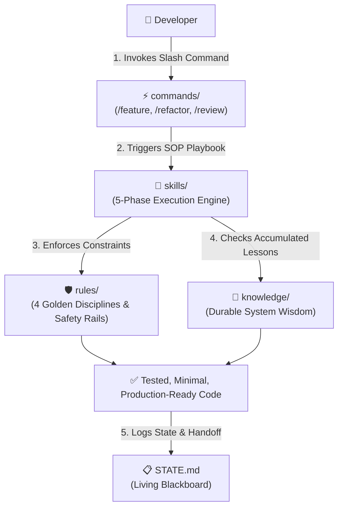

<div align="center">

# 🧠 Universal AI Operating System (AI-OS)

### The Production-Ready, Vendor-Agnostic AI Development Framework for Modern Software Engineering.

[](https://opensource.org/licenses/MIT)
[](#-universal-compatibility)
[](https://github.com/vantu1998/universal-ai-starter/pulls)
[](https://github.com/vantu1998/universal-ai-starter/stargazers)

<p align="center">
  <b>Tired of AI amnesia, context drift, hallucinated architecture, and vendor lock-in?</b><br>
  Universal AI-OS is a lightweight, spec-driven in-repo framework that turns LLMs from chaotic vibe-coders into disciplined Senior Engineers.
</p>

[Quick Start](#-quickstart-in-60-seconds) •
[Why AI-OS?](#-the-problem-vs-the-solution) •
[Core Pillars](#-the-4-pillars-architecture) •
[Handover Protocol](#-5-second-ai-handover-blackboard-pattern) •
[Commands & Skills](#-the-core-4-slash-commands)

---

</div>

## 💥 The Problem vs. The Solution

| Pain Point | Typical AI Coding (Vibe Coding) | With Universal AI-OS (Spec-Driven) |
| :--- | :--- | :--- |
| **Context Drift & Amnesia** | Long chats dilute attention, burning tokens and forgetting architecture after 20 messages. | **File-as-State:** Context is anchored in `STATE.md` and `.ai/` context maps. Reset context anytime with zero loss. |
| **Vendor Lock-in** | Prompts and rules are trapped inside proprietary IDE panels (Cursor, Claude, Copilot). | **Vendor-Agnostic:** 100% interoperable. Switch from Cursor to Claude Code or Antigravity in 5 seconds. |
| **Code Quality & Bloat** | AI writes speculative, overcomplicated abstractions and breaks domain invariants. | **4 Golden Disciplines:** Think before coding, Simplicity first, Surgical changes, Test-verified execution. |
| **Repeat Mistakes** | AI repeats the exact same subtle production bug in every new session. | **Continuous Learning:** `/knowledge-review` captures production lessons into durable repo memory. |

---

## 🏛️ The 4 Pillars Architecture



### Repository Layout

```text
universal-ai-starter/
├── AGENTS.md               # 🌟 Master Entry Point: Project stack & invariant contract
├── STATE.md                # 📋 The Living Blackboard: Real-time sprint state & handover
├── ROADMAP.md              # 🗺️ Task Decomposition: Micro-task backlog ([ ] and [x])
├── .cursorrules            # 🔌 Zero-config pointer for Cursor compatibility
│
└── .ai/                    # 🧠 The In-Repo AI Operating System
    ├── commands/           # Human-invoked entry points (/feature, /refactor, /review...)
    ├── skills/             # Multi-phase execution playbooks (SOPs)
    ├── rules/              # Strict behavioral invariants & safety guardrails
    └── knowledge/          # Project wisdom & incident learnings (empty by default)
```

---

## ⚡ Quickstart

### Option A: Install into ANY Existing Project (Recommended)

Run this one-liner inside your existing repository to immediately inject Universal AI-OS:

**macOS / Linux / WSL / Git Bash:**
```bash
curl -sSL https://raw.githubusercontent.com/vantu1998/universal-ai-starter/main/install.sh | bash
```

**Windows (PowerShell):**
```powershell
irm https://raw.githubusercontent.com/vantu1998/universal-ai-starter/main/install.ps1 | iex
```

---

### Option B: Clone as a Fresh Project

```bash
git clone https://github.com/vantu1998/universal-ai-starter.git my-awesome-project
cd my-awesome-project
```

---

### Next: Configure `AGENTS.md` (Takes 30 seconds)
Open `AGENTS.md` and customize Section 1 for your tech stack:
```markdown
- **Project Name:** My Next-Gen API
- **Language & Runtime:** Go 1.23 / Java 21 / TypeScript / Python 3.12
- **Framework:** Gin / Spring Boot 3 / Next.js / FastAPI
- **Primary Architecture:** Clean / Hexagonal Architecture
```

### Start Pairing!
Open the project in **Cursor**, **Claude Code**, **Antigravity**, or **Windsurf**. 
Prompt your AI:
> *"Read `AGENTS.md` and `STATE.md`, then execute Task 1.1 in `ROADMAP.md`."*

---

## 🔄 5-Second AI Handover (Blackboard Pattern)

Need to switch tools because you hit an API quota or prefer Cursor for editing and Claude for CLI?

```
[ Antigravity / Claude ] ──> Updates STATE.md ──> Git Commit
                                                     │
[ Cursor / Windsurf ]   <── Reads STATE.md   <───────┘
```

1. **Before concluding your session**, tell the current AI:
   > *"Update `STATE.md` for handover."*
2. **Open the project in your new tool**, and prompt:
   > *"Read `STATE.md` and resume work."*

The new AI instantly knows what was finished, what is in-progress, and what to do next—**without reading 50 chat messages or burning unnecessary tokens**.

---

## 🛠️ The Core 4 Slash Commands

Universal AI-OS comes pre-loaded with four standardized developer workflows:

| Slash Command | Role | What the AI does |
|---|---|---|
| **`/feature`** | **Feature Engineering** | Executes a 5-phase lifecycle: Requirements Scope → Impact Analysis → Test-First Spec → Implementation → Verification. |
| **`/refactor`** | **Safe Refactoring** | Maps domain invariants, identifies safety boundaries, refactors incrementally, and guarantees zero behavioral regressions. |
| **`/review`** | **Automated Code Review** | Evaluates git diffs against a rigorous Senior Engineer rubric: correctness, security, performance, test coverage, and code hygiene. |
| **`/knowledge-review`** | **Continuous Learning** | Analyzes recently solved bugs/incidents and distills them into permanent documentation in `.ai/knowledge/`. |

---

## 🛡️ The 4 Golden Disciplines (`behavior.md`)

Every AI working under this system is strictly constrained by 4 foundational rules:
1. **Think Before Coding:** Surface implicit assumptions, tradeoffs, and edge cases before touching files.
2. **Simplicity First:** Write the minimum code necessary. No speculative abstractions or unrequested configurability.
3. **Surgical Changes:** Modify only what is required. Keep git diffs minimal. Never touch unrelated code.
4. **Goal-Driven Verification:** No task is declared complete until automated tests pass via terminal execution.

---

## 🌐 Universal Compatibility

Universal AI-OS is 100% vendor-agnostic and tested with:

| Tool / Agent | Support Level | Integration Mechanism |
| :--- | :---: | :--- |
| **Cursor** | Native | Reads `.cursorrules` pointer → anchors to `AGENTS.md` & `STATE.md` |
| **Claude Code (CLI)** | Native | Reads `AGENTS.md` & `CLAUDE.md` entry point |
| **Antigravity (AGY)** | Native | Reads root `AGENTS.md` and `.ai/` context maps |
| **Codeium Windsurf** | Native | Reads `AGENTS.md` / `.windsurfrules` |
| **GitHub Copilot** | Native | Reads workspace context & `AGENTS.md` |
| **OpenHands / Aider** | Native | Reads root `AGENTS.md` and `CONVENTIONS.md` |

---

## 🤝 Contributing

Contributions are warmly welcomed! If you have optimized skills, language-specific rule packs, or tool adapters:
1. Fork the repository
2. Create your feature branch (`git checkout -b feature/awesome-skill`)
3. Commit your changes (`git commit -m 'feat: add python-fastapi rule pack'`)
4. Push to the branch (`git push origin feature/awesome-skill`)
5. Open a Pull Request

---

## ⭐️ Show Your Support

If this framework helps you save tokens, eliminate AI hallucinations, or streamline your engineering workflow, please give it a **⭐️ Star on GitHub**!

---

## 📜 License
Distributed under the **MIT License**. See [`LICENSE`](LICENSE) for more information.
